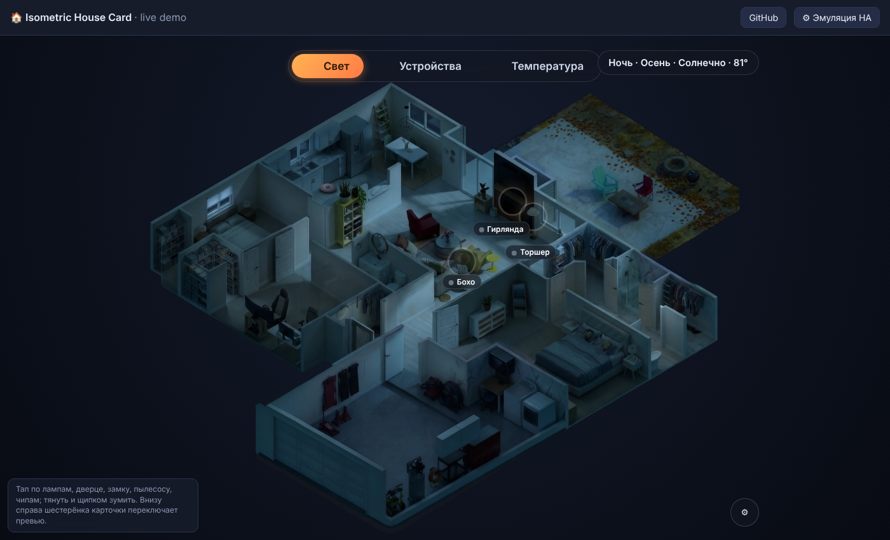

# Isometric House Card for Home Assistant

A stylish **3D isometric floor plan** dashboard card for Home Assistant. The house is a single rendered image that changes with the **time of day** (from the sun), the **season** and the **weather**; lamps glow, the TV plays, the fridge doors open, a robot vacuum drives around, and little residents sit in their armchairs by day and sleep in bed at night.



**▶ Live demo: https://skazo4nik.github.io/ha-isometric-house-card/** (no Home Assistant needed)

Source of the demo: `demo/` — the page ships a tiny in-browser Home Assistant emulator, so every control works. Enable GitHub Pages (Settings → Pages → Source: GitHub Actions) and the included workflow publishes it.

Run it locally:

```bash
python3 -m http.server 8080
# open http://localhost:8080/demo/
```

## What it does

| Tab | Features |
|---|---|
| **Свет / Light** | tap a lamp to toggle it; soft glow that matches the scene's light; weather effects (rain, snow, wind, clouds) drawn over the yard only |
| **Устройства / Devices** | TV overlay, fridge + freezer doors with real temperatures, washer/dryer countdown, robot vacuum that moves on the plan, front door lock (tap to lock, confirm to unlock) |
| **Температура / Temperature** | indoor/outdoor chips, thermostat dialog (mode, setpoint), optional "occupancy" select and auto switch |
| **People** | two residents: in armchairs by day, in bed at night (both / one / the other), hidden if away |
| **Mobile** | pan, pinch-zoom, double-tap, wheel; narrow-screen layout starts zoomed in |

Scenes: 4 times of day × 4 seasons = 16 images, crossfaded, all with transparent background so the dashboard colour shows through. The UI text is Russian (labels live at the top of `dist/house3d-card.js`).

## Install in Home Assistant

1. Copy `dist/house3d-card.js` to `/config/www/house3d/` and everything from `demo/assets/` next to it.
2. Settings → Dashboards → Resources → add `/local/house3d/house3d-card.js` as **JavaScript module**. (Use a new file name or `?v=` suffix after each update; browsers cache aggressively.)
3. Create a dashboard in **panel** (single card) mode:

```yaml
views:
  - title: 3D Home
    path: main
    panel: true
    cards:
      - type: custom:house3d-card
        base: /local/house3d/     # where the images live
        # auto_path: /my-dash/thermostat   # optional: shows an "Automations" button for admins
```

### Entities the card reads

Rename them in `dist/house3d-card.js` to match your system (search for the id).

| Purpose | Entity |
|---|---|
| Lamps | `light.floor_lamp`, `light.boho_lamp`, `light.fireplace_lights` |
| TV | `media_player.living_room_tv` |
| Fridge | `binary_sensor.kitchen_refrigerator_fridge_door`, `…_freezer_door`, `sensor.kitchen_refrigerator_fridge_temperature`, `…_freezer_temperature` |
| Washer / dryer | `sensor.garage_washer_machine_state`, `sensor.garage_dryer_machine_state` (`run` / `pause` / `stop`) and `…_completion_time` |
| Vacuum | `vacuum.robot_vacuum` |
| Lock | `lock.front_door_lock` |
| Thermostat | `climate.thermostat`, `sensor.thermostat_indoor_temperature`, `sensor.thermostat_outdoor_temperature`, `input_select.thermo_situation`, `input_boolean.thermo_auto` |
| People | `person.resident_a`, `person.resident_b` |
| Sun / weather | `sun.sun`, `weather.forecast_home` |

Time of day comes from `sun.sun` elevation (day > 12°, night ≤ −6°, otherwise dawn/sunset); season from the month.

## Gear menu (bottom right)

Preview overrides for time, season, weather and who is home. Stored in the browser only (`localStorage`), never in HA.

## How the scenes were made

The base is an isometric render of the house (2400×1851, transparent background). Every other scene (times of day, seasons, open fridge, residents) is generated from that base with an image model, aligned back to the base with OpenCV (SIFT + affine), masked, relit and saved as webp, so furniture never moves between scenes. Lamp glow and weather are canvas effects at runtime.

## Make it yours

The geometry (lamp positions, device chips, yard polygon, people patches) is in coordinates of the 2400×1851 frame at the top of `dist/house3d-card.js`. Swap the images, adjust those numbers, done.

## License

Code: MIT. Images in `demo/assets/`: all rights reserved by the author, provided for the demo; ask before reusing.
